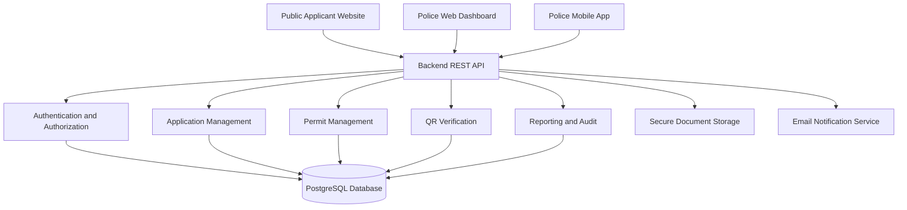

# TintVerify-Gambia
## System Architecture and Database Design

**Document Version:** 1.0  
**Status:** Draft — For Developer Review  
**Project:** TintVerify-Gambia  
**Initial Scope:** Vehicle Tinted-Glass Permit Application and Verification

---

# PART A: SYSTEM ARCHITECTURE

## 1. Architecture Overview

TintVerify-Gambia will use a centralised backend architecture.

Three applications will communicate with one backend API and share the same database.

The applications are:

1. Public Applicant Website.
2. Police Administrative Web Dashboard.
3. Police Mobile Application.

### 1.1 System Architecture Diagram



All applications shall use the same central source of information.

For example:

- An applicant submits an application through the public website.
- The backend saves it in the database.
- A reviewer sees the application in the police dashboard.
- An issuing officer records permit issuance.
- A traffic officer scans the QR code using the mobile application.
- The mobile application retrieves the verification result from the same backend.

## 2. Proposed Technology Stack

The following technologies are proposed for developer agreement. They are not yet final until both developers review and approve them.

| Component | Proposed Technology |
|---|---|
| Public website | Next.js and TypeScript |
| Police dashboard | Next.js and TypeScript |
| Mobile application | React Native with Expo |
| Backend | NestJS with TypeScript |
| Database | PostgreSQL |
| ORM | Prisma |
| API | REST API |
| API documentation | OpenAPI / Swagger |
| Styling | Tailwind CSS |
| UI components | shadcn/ui |
| Version control | Git and GitHub |
| Backend testing | Jest |
| Frontend testing | Vitest |
| End-to-end testing | Playwright |

### 2.1 Why This Stack?

The proposed stack uses TypeScript across the frontend and backend.

This can make it easier for two developers to share data types, API contracts and validation rules.

It also supports the development of a public website, administrative dashboard and mobile application within one connected project.

## 3. Repository Architecture

The project shall use a GitHub monorepo.

A monorepo means that the different applications and shared project packages are stored in one repository.

### Proposed Folder Structure

```text
tintverify-gambia/
│
├── apps/
│   ├── api/
│   │   └── Backend application
│   │
│   ├── public-web/
│   │   └── Public applicant website
│   │
│   ├── police-dashboard/
│   │   └── Police administrative dashboard
│   │
│   └── police-mobile/
│       └── Police mobile application
│
├── packages/
│   ├── contracts/
│   │   └── Shared API types and contracts
│   │
│   └── config/
│       └── Shared configuration
│
├── docs/
│   ├── README.md
│   ├── SRS.md
│   ├── ARCHITECTURE.md
│   ├── DATABASE.md
│   ├── API-CONTRACT.md
│   └── DEVELOPMENT-ROADMAP.md
│
├── AGENTS.md
├── README.md
├── .gitignore
└── package.json
```

The folder structure is a proposed target. It does not mean all folders must be created immediately.

## 4. Application Responsibilities

### 4.1 Public Applicant Website

The public website shall provide:

- Applicant registration.
- Email verification.
- Login and password recovery.
- Applicant profile management.
- Individual application submission.
- Company application submission.
- Representative application submission.
- Vehicle information entry.
- Document uploads.
- Application status tracking.
- Additional-information responses.
- Application history.
- Permit history.
- Renewal and replacement requests.

The website must be responsive and work on mobile phones, tablets and computers.

Applicants shall not need to install a mobile application.

### 4.2 Police Administrative Dashboard

The dashboard shall provide:

- Secure staff login.
- Role-based navigation.
- Application review.
- Document examination.
- Additional-information requests.
- Approval and rejection.
- Payment verification records.
- Permit issuance.
- Permit revocation.
- Permit amendments.
- Staff account management.
- Fee configuration.
- Reports.
- Audit logs.

Each role shall only access its authorised functions.

### 4.3 Police Mobile Application

The mobile application shall provide:

- Secure officer login.
- QR code scanning.
- Permit verification.
- Manual vehicle registration search.
- Manual Permit ID search.
- Suspected forged permit reporting.
- Verification history.
- Limited offline verification.

The home screen shall display a prominent Scan QR Code option.

The camera must not open automatically immediately after login.

## 5. Backend Architecture

The backend shall manage the business logic and provide API access to all three applications.

### Proposed Backend Modules

1. Authentication Module.
2. User and Profile Module.
3. Staff Management Module.
4. Role and Permission Module.
5. Application Module.
6. Document Management Module.
7. Application Review Module.
8. Approval Module.
9. Payment Verification Module.
10. Fee Management Module.
11. Permit Management Module.
12. QR Verification Module.
13. Renewal and Replacement Module.
14. Revocation Module.
15. Notification Module.
16. Reporting Module.
17. Audit Log Module.

Modules should be separated logically to make future development and maintenance easier.

## 6. API Communication

The applications shall communicate with the backend through secure REST API endpoints.

All API requests involving sensitive information shall require authentication and appropriate authorisation.

Example endpoint groups:

| Endpoint | Purpose |
|---|---|
| `/api/auth` | Authentication |
| `/api/users` | Applicant accounts |
| `/api/staff` | Police staff accounts |
| `/api/applications` | Applications |
| `/api/reviews` | Application review |
| `/api/approvals` | Approval decisions |
| `/api/payments` | Physical payment verification records |
| `/api/permits` | Permit management |
| `/api/verification` | QR and manual verification |
| `/api/reports` | Reports |
| `/api/audit-logs` | Audit records |

The exact endpoints, request formats and response structures shall be documented in `API-CONTRACT.md`.

## 7. Authentication and Authorization

The backend shall enforce authentication and role-based access control.

Important requirements:

- Individual accounts.
- Secure password hashing.
- Two-factor authentication.
- Email verification.
- Session management.
- Automatic logout after inactivity.
- Protection against repeated failed login attempts.
- Permission checks on the backend.
- Secure password recovery.

Frontend restrictions alone are not sufficient. The backend must verify permissions for every protected operation.

## 8. Document Storage

Uploaded documents shall be stored separately from ordinary database records.

The database shall store document metadata and secure storage references.

The system shall support:

- PDF.
- JPG/JPEG.
- PNG.

Documents shall be protected against unauthorised access.

The system shall validate uploads and perform malware scanning.

## 9. Notifications

The initial system shall use email notifications.

A notification service shall support:

- Account verification.
- Application submission.
- Additional-information requests.
- Approval and rejection.
- Payment instructions.
- Payment deadline notifications.
- Extension decisions.
- Permit issuance and collection instructions.

SMS integration may be added later.

## 10. Offline Verification Architecture

The mobile application shall support limited offline verification.

When online, the application may securely cache permitted verification information.

When offline:

- The application shall identify the result as cached/offline.
- It shall display the last successful synchronisation time where available.
- It shall warn that recent expiry or revocation changes may not be reflected.
- It shall synchronise when connectivity returns.

Offline information must not be represented as current confirmation.

---

# PART B: DATABASE DESIGN

## 11. Database Overview

The proposed database is PostgreSQL.

Prisma ORM is proposed for database access.

The database shall maintain relationships between:

- Applicants.
- Staff accounts.
- Applications.
- Vehicles.
- Uploaded documents.
- Review records.
- Approval decisions.
- Payment verification records.
- Permits.
- QR verification tokens.
- Revocations.
- Renewals.
- Replacement requests.
- Notifications.
- Reports.
- Audit logs.

## 12. Proposed Database Entities

### 12.1 Users

Stores applicant account information.

Proposed fields:

- id
- full_name
- email
- phone
- password_hash
- email_verified_at
- account_status
- created_at
- updated_at

Applicant type and profile-specific information shall be managed through related profile records.

### 12.2 Applicant Profiles

Stores information specific to applicant categories.

Proposed fields:

- id
- user_id
- applicant_type
- date_of_birth
- residential_address
- driving_licence_number
- company_name
- business_registration_number
- company_address
- representative_name
- representative_contact
- created_at
- updated_at

The design must support individual, company and authorised representative applications without unnecessarily duplicating user account information.

### 12.3 Staff Users

Stores police staff account information.

Proposed fields:

- id
- full_name
- email
- phone
- password_hash
- account_status
- two_factor_enabled
- created_at
- updated_at

Staff accounts shall be created by authorised senior administrators.

### 12.4 Roles

Stores system roles.

Proposed fields:

- id
- role_name
- description
- created_at

Initial roles:

- APPLICATION_REVIEWER
- APPROVING_OFFICER
- PAYMENT_VERIFICATION_OFFICER
- PERMIT_ISSUING_OFFICER
- TRAFFIC_POLICE_OFFICER
- SENIOR_SYSTEM_ADMINISTRATOR
- MANAGEMENT_AUDITOR

### 12.5 Permissions

Stores individual system permissions.

Proposed fields:

- id
- permission_name
- description

A staff member may have one or more assigned roles according to the approved permission policy.

### 12.6 Staff Role Assignments

Connects staff accounts with roles.

Proposed fields:

- id
- staff_user_id
- role_id
- assigned_by
- assigned_at

Role changes shall generate audit records.

### 12.7 Vehicles

Stores vehicle information.

Proposed fields:

- id
- registration_number
- make
- model
- colour
- created_at
- updated_at

Vehicle year and chassis/VIN are not required in the initial system.

Registration numbers shall be handled consistently and protected against accidental duplicate records.

### 12.8 Applications

Stores permit application records.

Proposed fields:

- id
- application_reference
- applicant_user_id
- vehicle_id
- application_type
- status
- submitted_at
- updated_at

An application may be linked to one applicant and one vehicle.

An applicant may submit multiple applications.

### 12.9 Application Documents

Stores metadata for uploaded documents.

Proposed fields:

- id
- application_id
- document_type
- original_filename
- storage_key
- mime_type
- file_size
- uploaded_by
- uploaded_at
- scan_status

The actual document files shall be stored securely outside the relational database.

### 12.10 Application Reviews

Stores reviewer activity.

Proposed fields:

- id
- application_id
- reviewer_id
- recommendation
- comments
- reviewed_at

Recommendations:

- APPROVE
- REJECT
- REQUEST_INFORMATION

Reviewers cannot directly make final approval decisions.

### 12.11 Approval Decisions

Stores final approval decisions.

Proposed fields:

- id
- application_id
- approving_officer_id
- decision
- reason
- decided_at

The approving officer must be different from the reviewer responsible for the recommendation.

### 12.12 Additional Information Requests

Stores requests for missing information.

Proposed fields:

- id
- application_id
- requested_by
- request_description
- response
- status
- requested_at
- responded_at

Applicants shall respond to the same application.

### 12.13 Payment Verification Records

Stores the manual verification outcome.

Proposed fields:

- id
- application_id
- verification_status
- verified_by
- verification_notes
- verified_at

The initial system shall not implement a detailed payment ledger or automated bank verification.

### 12.14 Permit Fees

Stores configurable fee information.

Proposed fields:

- id
- fee_amount
- currency
- effective_from
- effective_until
- is_active
- created_by
- created_at

Fee changes shall be recorded in a separate fee history or audit record.

### 12.15 Permits

Stores issued permit records.

Proposed fields:

- id
- permit_id
- application_id
- vehicle_id
- applicant_user_id
- issue_date
- expiry_date
- status
- issued_by
- created_at

Each issued permit shall have a unique Permit ID.

### 12.16 QR Verification Tokens

Stores secure QR verification information.

Proposed fields:

- id
- permit_id
- token_hash
- created_at
- revoked_at

The QR token shall be unique and securely generated.

The actual secret token should not be stored in plaintext where avoidable.

### 12.17 Permit Revocations

Stores revocation information.

Proposed fields:

- id
- permit_id
- revoked_by
- reason
- revoked_at

Only authorised senior approving officers may perform revocation.

### 12.18 Renewal Requests

Stores renewal activity.

Proposed fields:

- id
- previous_permit_id
- new_application_id
- status
- requested_at
- completed_at

A renewal shall create a new permit record while preserving the previous permit.

### 12.19 Replacement Requests

Stores lost or damaged permit requests.

Proposed fields:

- id
- permit_id
- applicant_user_id
- reason
- status
- requested_at
- reviewed_by
- reviewed_at

Replacement requests shall not automatically reset permit validity.

### 12.20 Notifications

Stores notification records.

Proposed fields:

- id
- recipient_user_id
- notification_type
- subject
- delivery_status
- sent_at
- created_at

Email delivery shall be supported initially.

### 12.21 Audit Logs

Stores important system activity.

Proposed fields:

- id
- actor_type
- actor_id
- action
- entity_type
- entity_id
- details
- ip_address
- created_at

Audit records shall be protected against unauthorised modification and deletion.

Sensitive information, passwords and authentication secrets must not be written into audit details.

### 12.22 Verification Logs

Stores QR and manual verification activity.

Proposed fields:

- id
- officer_id
- permit_id
- search_type
- verification_result
- device_reference
- verified_at

The design may include location information only if approved by the applicable policy.

---

## 13. Main Database Relationships

The following relationships are proposed:

1. One applicant user can have multiple applications.
2. One vehicle can have multiple historical applications.
3. One application can have multiple documents.
4. One application can have multiple review records.
5. One application can have one or more additional-information requests.
6. One application can have a final approval decision.
7. One application can have a payment verification record or verification history.
8. One successfully issued application can produce a permit.
9. One permit has one unique QR verification identity.
10. One permit may have a revocation record.
11. One previous permit may be linked to a renewal.
12. One permit may have replacement requests.
13. One staff member can have multiple assigned roles.
14. One staff member can generate multiple audit records.
15. One officer can generate multiple verification records.

## 14. Important Database Rules

The implementation shall enforce:

- Unique applicant email addresses.
- Unique staff email addresses.
- Unique application references.
- Unique Permit IDs.
- Unique QR verification tokens.
- Valid application-to-vehicle relationships.
- Valid application-to-applicant relationships.
- Proper role and permission checks.
- No direct editing of issued permit records.
- Preservation of historical applications and permits.
- Audit logging for sensitive actions.

Database constraints and transactions shall be used where appropriate to prevent inconsistent records.

## 15. Data Retention

Application and permit history shall be preserved for future auditing.

Uploaded document retention and deletion periods must be configurable or implemented according to the final approved retention policy.

The prototype shall not assume an official retention period.

---

# PART C: DEVELOPER COORDINATION

## 16. Development Responsibilities

### Backend Developer

Responsible for:

- Backend project setup.
- Database schema.
- Prisma models and migrations.
- Authentication.
- Authorisation.
- REST API development.
- Business logic.
- Document storage.
- Email notifications.
- QR token generation and verification.
- Audit logging.
- Backend testing.
- API documentation.

### Frontend Developer

Responsible for:

- Public applicant website.
- Police web dashboard.
- Police mobile application.
- Responsive layouts.
- Forms and validation.
- Applicant workflow interfaces.
- Staff dashboard interfaces.
- QR scanning interface.
- Verification result screens.
- Offline user experience.
- Frontend testing.

### Shared Responsibilities

Both developers shall agree on:

- Technology stack.
- Database structure.
- API contracts.
- Shared data types.
- Application status names.
- Authentication flow.
- Role permissions.
- Integration testing.
- Final prototype demonstration.

## 17. API Contract Coordination

The frontend and backend must agree on API request and response formats before integrating individual modules.

Shared contracts shall be maintained in:

`packages/contracts`

API specifications shall be maintained in:

`docs/API-CONTRACT.md`

Changes to API structures must be communicated and reviewed by both developers.

## 18. Version Control

The team shall use the shared GitHub repository.

Proposed workflow:

- `main`: stable project code.
- `develop`: integration branch.
- Feature branches: individual tasks.
- Pull requests: review before merging into shared branches.

Both developers shall:

- Commit frequently.
- Use clear commit messages.
- Avoid committing passwords, API keys or secrets.
- Review changes before merging.
- Keep documentation updated.

## 19. Important Implementation Principles

1. Security must be enforced by the backend, not only the frontend.
2. The reviewer and approving officer must remain separate.
3. QR verification must use a secure unique token.
4. Issued permits must not be edited directly.
5. All important administrative actions must be auditable.
6. The three applications must use the same backend.
7. Historical records must be preserved.
8. All demonstration records must be fictional.
9. The prototype must not imply official government approval.
10. Unconfirmed policy decisions must remain configurable.

---

**End of Document**

**Document status:** Version 1.0 Draft — Both developers must review and agree on the proposed architecture, stack, schema and implementation details before treating them as final.
